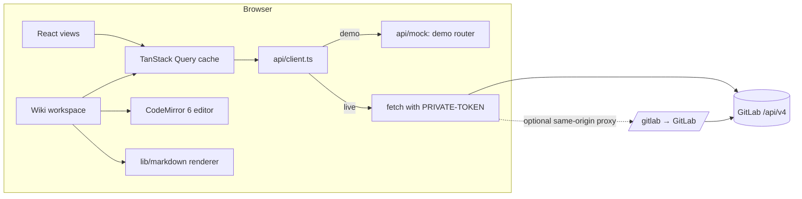

# GitLab Everything: specification

This document describes what the portal does, how it is built, and how to extend it. It is the reference for anyone implementing enhancements. When the code and this document disagree, fix one of them in the same change.

**Contents**

1. [Purpose and scope](#1-purpose-and-scope)
2. [Architecture](#2-architecture)
3. [Source layout](#3-source-layout)
4. [Connection and data sources](#4-connection-and-data-sources)
5. [API client, caching and writes](#5-api-client-caching-and-writes)
6. [Routing, scope and views](#6-routing-scope-and-views)
7. [Portal views](#7-portal-views)
8. [Wiki workspace](#8-wiki-workspace)
9. [Markdown rendering contract](#9-markdown-rendering-contract)
10. [GitLab endpoints used](#10-gitlab-endpoints-used)
11. [User interface system](#11-user-interface-system)
12. [Security](#12-security)
13. [Testing](#13-testing)
14. [Build and deployment](#14-build-and-deployment)
15. [How to extend](#15-how-to-extend)
16. [Known limits and roadmap](#16-known-limits-and-roadmap)
17. [Conventions](#17-conventions)

---

## 1. Purpose and scope

GitLab Everything is a single web portal over the GitLab REST API (v4) for **one top-level group and everything nested under it**. It answers the questions a team lead or platform engineer asks across many projects at once, and lets them act on the answers:

- What is failing, stale or risky across all our projects right now?
- Which merge requests and issues are open, where, and in what state?
- Who has access to what, and where was it granted?
- What do our wikis say, and can I fix a page without leaving the portal?

**In scope:** reading groups, projects, merge requests, issues, pipelines and jobs, branches and commits, members, events, search results and wiki pages; a small set of writes (create and close issues, approve merge requests, retry pipelines, create, edit, rename and delete wiki pages, upload wiki attachments); a raw API explorer.

**Out of scope (by decision):** anything the GitLab API does not provide, such as wiki page history; administration of the instance; a server component. The app is a static site that talks to GitLab directly from the browser.

**Users:** people with a GitLab account and a personal access token. The portal only shows what that token can see.

## 2. Architecture



| Concern | Choice | Why |
| --- | --- | --- |
| Framework | React 18 + TypeScript (strict) | Widely known; typed API models |
| Build | Vite 5 | Fast dev server, code splitting, simple static output |
| Routing | React Router 6 (`BrowserRouter`) | Bookmarkable URLs for every scope, view and wiki page |
| Server state | TanStack Query 5 | Caching, deduplication, refetch and invalidation after writes |
| Editor | CodeMirror 6 | Markdown language with nested code languages, search, autocompletion, linting, multiple cursors |
| Markdown | Own renderer in `lib/markdown/render.ts` | Escape-first safety, `data-line` source mapping for scroll sync and task toggling, GitLab-specific syntax |
| Code highlighting | highlight.js (common languages) | Small, synchronous |
| Math | KaTeX, MathML output | Renders without extra CSS or fonts |
| Diagrams | Mermaid 10, loaded on demand | Matches GitLab's diagram syntax |
| Sanitising GitLab HTML | DOMPurify | For the optional "rendered by GitLab" mode |
| Tests | Vitest (unit), Playwright (end to end) | |

The wiki workspace is a separate lazy-loaded chunk, so the portal itself stays around 300 KB of JavaScript.

## 3. Source layout

```
src/
  main.tsx, App.tsx       Entry point and routes
  api/
    types.ts              GitLab response fields the app reads
    connection.ts         Demo/live settings store (useConnection)
    client.ts             request / get / getAll / write / upload, ApiError, call log
    hooks.ts              QueryClient, Tree and Scope, all data hooks, useWrite
    mock/data.ts          Deterministic demo company
    mock/router.ts        Answers /api/v4 paths from the demo data
  components/
    ui.tsx                Icon, StatusPill, Avatar, Labels, Tag, Segmented, SearchBox, Empty, ErrorBox, Tile, Loaded
    Drawers.tsx           Merge request, issue and pipeline detail drawers
    NewIssueModal.tsx     Create-issue dialog
    names.ts              useNames(): project names and root-relative paths
  layout/
    Shell.tsx             Top bar, rail, outlet; useRouteScope()
    GroupTree.tsx         Expandable group and project tree
  views/
    registry.ts           The list of tabs (add views here)
    ScopePage.tsx         Header, tabs and the selected view
    Overview, Projects, MergeRequests, Issues, Pipelines, Repository, Members, Activity, Search, ApiExplorer, WikiDirectory, Connection
  wiki/
    WikiWorkspace.tsx     Full-screen routes and render context
    Reader.tsx            Page tree, rendered page, "On this page"
    Editor.tsx            Editor screen: toolbar, preview, changes, side panel, saving
    MarkdownView.tsx      Rendered Markdown with diagrams, anchors, references, tasks
    prefs.ts              Per-browser wiki preferences, demo uploads
    editor/setup.ts       CodeMirror extensions, keymap, theme
    editor/commands.ts    Formatting and table commands
    editor/completions.ts /, [[, #, !, @ and : suggestions
    editor/parts.tsx      Popovers, side panel, changes view, template picker
  lib/
    format.ts, icons.ts, labels.ts
    markdown/render.ts    Markdown renderer
    markdown/extras.ts    Emoji, highlighting, math, Mermaid
    markdown/sanitize.ts  Cleans GitLab-rendered HTML
    wiki/paths.ts, tables.ts, checks.ts, diff.ts, templates.ts, tree.ts
  state/
    toast.tsx             useToast(), useCopy()
    overlays.tsx          useOverlays(): drawers and dialogs
  styles/app.css          Tokens and all styles
```

Rule of thumb: **`lib/` is pure** (no React, no network) and unit-tested; **`api/` owns all GitLab access**; views never call `fetch` directly.

## 4. Connection and data sources

`api/connection.ts` holds a single store:

| Field | Meaning |
| --- | --- |
| `mode` | `demo` (answered by `api/mock`) or `live` (sent to GitLab) |
| `base` | GitLab URL, or a same-origin proxy path such as `/gitlab` |
| `token` | Personal access token, sent as `PRIVATE-TOKEN` |
| `root` | Path or ID of the top-level group |
| `remember` | Also keep the settings in `sessionStorage` for this tab |

Rules:

- The app starts in demo mode unless `sessionStorage` holds remembered live settings.
- Switching to live loads the group tree first; if that fails, the previous settings are restored and the error is shown.
- The token is never written to `localStorage`, the URL or logs. The call log stores method, path, status and duration only.
- `VITE_GITLAB_URL` and `VITE_GITLAB_ROOT_GROUP` prefill the form at build time.
- Every query key starts with a connection key, so demo and live data (and different instances) never mix in the cache.

**Demo data** (`api/mock/data.ts`) is built from a fixed seed: the same company every time, with dates relative to now. Writes change the in-memory data until the page reloads. Endpoints the demo does not model return 404 with a message saying so.

## 5. API client, caching and writes

`api/client.ts`:

| Function | Behaviour |
| --- | --- |
| `request(method, path, body?, conn?)` | One call. Never throws on HTTP errors; returns `{status, data, next, total, ms}`. Throws `ApiError(0)` only when the network fails. Records the call in the call log. |
| `get(path)` | GET, throws `ApiError` with a readable message on status ≥ 400 |
| `getAll(path, maxPages = 4)` | Adds `per_page=100&page=n` and follows `x-next-page` up to `maxPages` |
| `write(method, path, body)` | POST, PUT or DELETE, throws `ApiError` on failure |
| `upload(path, file)` | Multipart POST (wiki attachments) |
| `explain(status, data)` | Turns 401/403/404 into instructions the user can act on |

`api/hooks.ts` wraps these in TanStack Query:

- Default `staleTime` 60 s (tree: 5 min), one retry, no refetch on window focus.
- `useGet` / `useGetAll` for single endpoints; dedicated hooks for multi-request data (pipelines, members, events, wiki spaces).
- **Writes go through `useWrite()`**, which invalidates every query of the current connection afterwards. This is deliberately simple: correctness over minimal refetching.
- The refresh button in the top bar invalidates everything.

Fan-out limits (protect large instances):

| Data | Limit |
| --- | --- |
| Projects in the tree | 10 pages × 100 |
| Subgroups | 5 pages × 100 |
| Pipelines | last 14 days, 30 most recently active projects in scope, 1 page each |
| Events | 15 most recently active projects, 20 each |
| Group wikis checked | 25 groups; project wikis: 40 projects |
| Members: direct grants | 25 subgroups |

## 6. Routing, scope and views

| URL | Screen |
| --- | --- |
| `/` | Redirects to the top-level group's overview |
| `/g/:groupId/:view` | A group; `view` from `views/registry.ts` |
| `/p/:projectId/:view` | A project |
| `/connection` | Demo/live settings |
| `/wiki/:space` | A wiki's home page (or empty state) |
| `/wiki/:space/page/<slug>` | Reader; `#anchor` scrolls to a heading |
| `/wiki/:space/edit/<slug>` | Editor |
| `/wiki/:space/new?title=` | New page |

`space` is `group-<id>` or `project-<id>`. Slugs may contain slashes (nested pages).

**Tree** (`loadTree`): the root group, all descendant groups and all projects with `include_subgroups=true`. Loaded once per connection and shared by every view.

**Scope**: the group or project in the URL. A group scope includes everything nested under it. Every view receives `{ tree, scope }`. Group-level endpoints (`/groups/:id/merge_requests`, `/issues`, `/search`) already include subgroups; for data without a group endpoint (pipelines, events) the portal fans out per project.

Changing scope in the tree keeps the current view when it applies to the new scope type; otherwise it opens the overview.

## 7. Portal views

Every view shows a skeleton while loading, an error panel with *Try again* and *Check connection* on failure, and a specific empty state when there is nothing to show.

### Overview
- Four tiles linking to their views: projects (or, for a project, the latest default-branch pipeline), open merge requests (with the number open longer than 7 days), open issues (bugs and security), pipeline pass rate over 14 days.
- **Pipelines per day**: 14 stacked bars (passed, failed, other), with a tooltip per bar.
- **Needs attention**: failing default branches, open security issues (up to 3), non-draft merge requests open more than 7 days (up to 4). Each opens its drawer.
- **Subgroups** (groups with children): projects, open MRs, open issues, pass rate bar, failing default branches. Rows open the subgroup.

### Projects (groups only)
Filter by text; sort by recent activity, failing first, most open issues, name. Columns: name and namespace, latest default-branch pipeline, open MRs, open issues, visibility, last activity. Rows open the project.

### Merge requests
State: open, merged, closed. Filter by title, branch or project; hide drafts. Status uses `detailed_merge_status` (ready, needs approval, conflicts, CI running, open threads, …). The drawer shows branches, author, reviewers, labels, dates and description, and offers **Approve**.

### Issues
State: open, closed. Text filter and label chips. Overdue due dates are highlighted. The drawer offers **Close issue** with a confirm step. **New issue** (scope header) creates an issue in any project of the scope with title, description and labels.

### Pipelines
Status filter with counts, text filter. The drawer shows jobs grouped by stage and offers **Retry failed jobs** for failed or canceled pipelines.

### Repository (projects only)
Recent commits on the default branch; branches with default, protected and merged badges.

### Wiki
Directory of every wiki in scope (group wikis and project wikis) with their pages. Pages and *Open wiki* open the full-screen workspace. *New page* starts a page in the scope's own wiki. Wikis without pages are listed with a shortcut to create the first page. When group wikis are unavailable in live mode, the number of skipped groups is shown.

### Members
One row per person: highest role and every place access is granted (the scope including inherited access, plus direct grants in each subgroup), with expiry dates. Filter by text and role.

### Activity
Latest events from the most active projects, grouped by day: pushes, merge request and issue changes, comments.

### Search
Scopes: projects, issues, merge requests, wiki content (`wiki_blobs`). Wiki hits open the page in the reader. Group-wide wiki search needs Premium; the error explains this.

### API explorer
Catalog of endpoints by area; ones the portal uses are marked. Placeholders (`:group`, `:project`, `:pipeline_id`, `:slug`) are filled from the current scope. Only GET is sent from the explorer. The response shows status, time, item count, `x-total` and `x-next-page`, and highlighted JSON (truncated at 80 kB). Below: the session's call log (last 25 calls).

### Connection
Demo or live, URL, token, root group, *remember*. *Test connection* checks `/version`, `/user` and the group.

## 8. Wiki workspace

The workspace replaces the whole screen (`.wk`, fixed, full viewport). *Portal* returns to the Wiki tab of the wiki's owner.

### 8.1 Reader
- **Top bar:** back to portal, page-list toggle, wiki switcher (every group and project wiki in the tree), breadcrumbs, renderer switch (live mode: *Portal* or *GitLab*), full-width toggle, New page, Delete (two-step), Open in GitLab (live), Edit (also the **E** key).
- **Page list:** nested pages as folders, filter, current page highlighted. Closed by default on phones.
- **Page:** owner and format, title, slug, word count, reading time, section count, rendered content.
- **On this page:** headings up to level 3, highlights the section in view. Hidden below 1180 px.
- **Behaviour:**
  - Links to other pages open in the reader; links to pages that do not exist are dashed red and open the editor to create them.
  - Ticking a task checkbox saves the page immediately (`PUT`), keeping the scroll position.
  - Issue and MR references open their drawer.
  - The # next to a heading copies a link to that section.
  - Code blocks have a copy button.

### 8.2 Editor
**Screen:** top bar (cancel/close with unsaved-changes guard, wiki selector for new pages, title with slug preview, view switch, status, Save), toolbar, banners, panes, status bar.

**Views:** Write · Split (source and preview, scroll-synced, toggle *Scroll together*) · Preview · Changes (line diff against the version opened, or against the version someone else saved). On phones Split falls back to Write.

**Source editing (CodeMirror 6):**
- Markdown syntax highlighting, including inside fenced code blocks for every language in `@codemirror/language-data` (loaded on demand)
- Line numbers and line wrapping (toggles), active line, bracket matching, auto-closing brackets
- Undo/redo history, multiple cursors (Ctrl/Cmd+click, Alt+drag for rectangles), select next occurrence
- Find and replace panel with case, regular expression and whole-word options, replace all
- List continuation on Enter for bullets, numbers and tasks; Tab and Shift+Tab indent list items by marker width
- Spell checking by the browser

**Toolbar:**
- Formatting: undo, redo, heading menu (paragraph, H1–H6), bold, italic, strikethrough, inline code, highlight.
- Lists and blocks: bulleted, numbered and task lists, quote, outdent, indent, link, image or file upload, table size picker, code block with a language menu, divider.
- **Insert** menu: flowchart, sequence diagram, math block, inline math, collapsible section, callouts (note, tip, important, warning, caution), table of contents, footnote, today's date, mention, issue and MR reference, emoji, keyboard key.
- **Table** group, shown only when the cursor is in a table: insert row above or below, insert column left or right, delete row or column, align left, centre or right, tidy.
- Right side: templates, find, wrap, line numbers, and the side panel (outline, checks with a problem count, shortcuts).

**Typing suggestions:**

| Type | Suggests | Inserts |
| --- | --- | --- |
| `/` at line start or after a space | Blocks and commands | The block |
| `[[` | Pages of this wiki, plus "New page: …" | `[Title](slug)` |
| `#` (not at line start) | Open issues of the wiki's project or group | `#12`, or `group/project#12` from another project |
| `!` | Open merge requests | `!4` |
| `@` | Members with access | `@username` |
| `:` + letters | Emoji | `:rocket:` |

Suggestions never open inside code.

**Tables:** Tab and Shift+Tab move between cells and tidy the column widths; Tab past the last cell adds a row. Cells pasted from a spreadsheet become a table.

**Paste and drop:**
- Pasting a URL over selected text makes a link.
- Pasting or dropping files uploads them with `POST …/wikis/attachments` and inserts the Markdown GitLab returns. A placeholder shows while the upload runs.
- In demo mode, files stay in the browser tab as object URLs.

**Keyboard shortcuts** (Mod = Ctrl, or ⌘ on macOS):

| Action | Keys |
| --- | --- |
| Bold, italic, strikethrough, inline code | Mod+B, Mod+I, Mod+Shift+X, Mod+E |
| Link | Mod+K |
| Heading 1–6, paragraph | Mod+Alt+1–6, Mod+Alt+0 |
| Bulleted, numbered, task list, quote | Mod+Shift+8, Mod+Shift+7, Mod+Shift+9, Mod+Shift+. |
| Find, replace | Mod+F, Mod+H |
| Select next match | Mod+D |
| Move line, duplicate line | Alt+↑/↓, Mod+Shift+D |
| Toggle preview | Mod+Alt+P |
| Save | Mod+S |

**Checks** (`lib/wiki/checks.ts`), shown in the gutter, as underlines with hover messages and in the side panel:

| Severity | Rule |
| --- | --- |
| error | Link or image with no target; code block never closed; `javascript:` link; `<script>` tag |
| warning | Heading level jumps (e.g. 2 → 4); image without alt text; link without text; link to a page that does not exist in this wiki; table row with a different cell count from the header |
| info | Duplicate heading (its anchor gets a suffix); `#Heading` without a space; upload still in progress |

**Drafts:** while there are unsaved changes, the title and content are saved to `localStorage` every 800 ms under `gle-draft|<instance>|<space>|<slug or (new page)>`. On opening, a newer draft is offered with *Restore draft* / *Discard draft*. Saving or discarding removes it.

**Saving:**
1. A title is required.
2. For an existing page, the editor first reads the page again. If the content differs from the version it opened, it does not save and offers:
   - *Compare versions*, which shows the Changes view against their version;
   - *Save mine anyway*;
   - *Load their version*, which keeps yours as a draft.
3. It then sends `POST` (new) or `PUT` (existing). Changing the title renames the page and changes its slug, and slashes in a new title create nested pages.
4. After a successful save it clears the draft, refreshes caches and opens the saved page in the reader.

**Leaving:** *Close editor*, *Cancel* and browser unload warn when there are unsaved changes; *Discard changes* removes the draft.

**Templates:** blank, runbook, architecture decision, how-to, meeting notes, incident review, onboarding. A new empty page shows the template picker; the Templates menu inserts one at the cursor. `%TODAY%` becomes the current date.

**Preferences** (`wiki/prefs.ts`, `localStorage` key `gle-wiki-prefs`): view, side panel, page list open, full width, wrap, line numbers, scroll together, renderer.

## 9. Markdown rendering contract

`mdRender(src, ctx)` in `lib/markdown/render.ts` returns `{ html, headings }`.

**Safety:** the source is escaped first; only recognised constructs produce HTML. Allowed inline tags: `kbd sup sub mark ins del b i u s small abbr br`. Links are external (`http`, `https`, `mailto`, `tel`, opened in a new tab), in-page (`#…`), uploads, or wiki pages; any other scheme renders as text. Images accept `http(s)`, `data:image/` and `blob:` URLs and uploads.

**Supported syntax:**
- **Text:** paragraphs and hard breaks; emphasis, strong, strikethrough, `==highlight==`; inline code and `$`math`$`.
- **Headings:** ATX and setext.
- **Code and math:** fenced code (` ``` ` and `~~~`) with highlighting, `mermaid` and `math` fences, `$$` blocks.
- **Structure:** tables with alignment; ordered, unordered and task lists, nested and tight or loose; blockquotes; alerts `> [!note|tip|important|warning|caution]`; `<details>`/`<summary>`; `[[_TOC_]]` or `[TOC]`; footnotes; reference links; front matter (shown collapsed).
- **Links:** `[[Page]]` and `[[Text|page]]`, autolinks, bare URLs.
- **References and emoji:** `:emoji:`, `#12`, `!4`, `group/project#12`, `@user`.

**Contract with the editor and reader:**
- Every top-level block carries `data-line` = its 0-based source line. Scroll sync depends on this.
- Task checkboxes carry `data-src-line`; the reader and preview toggle that exact line.
- Heading elements have `id="wkh-<anchor>"`; anchor links use `data-anchor="<anchor>"` and `href="#"`. Use `findAnchor(container, anchor)`, which also understands GitLab's `user-content-` ids. In-page links must never change the URL, because the router owns it.
- Wiki links carry `data-wiki` (slug) and `data-hash`; missing pages get the class `broken`.
- References carry `data-ref="<#|!><projectId>:<iid>"`.
- Mermaid blocks render as `.mermaid-box[data-mermaid]` and are drawn by `renderMermaid(container)` after insertion.

**GitLab renderer (live):** `POST /markdown` with `gfm: true` and the project path. Output goes through `sanitizeGitLabHtml`: DOMPurify, absolute links and images, in-page anchors rewritten, Mermaid and math placeholders rendered, checkboxes disabled. Task toggling is not available in this mode.

## 10. GitLab endpoints used

| Feature | Endpoint |
| --- | --- |
| Group tree | `GET /groups/:id`, `GET /groups/:id/descendant_groups?all_available=true`, `GET /groups/:id/projects?include_subgroups=true&archived=false` |
| Merge requests | `GET /groups/:id/merge_requests?scope=all&state=…`, `GET /projects/:id/merge_requests`, `GET /projects/:id/merge_requests/:iid`, `POST /projects/:id/merge_requests/:iid/approve` |
| Issues | `GET /groups/:id/issues?scope=all&state=…`, `GET /projects/:id/issues/:iid`, `POST /projects/:id/issues`, `PUT /projects/:id/issues/:iid` (`state_event=close`) |
| Pipelines | `GET /projects/:id/pipelines?updated_after=…`, `GET /projects/:id/pipelines/:id/jobs`, `POST /projects/:id/pipelines/:id/retry` |
| Repository | `GET /projects/:id/repository/branches`, `GET /projects/:id/repository/commits` |
| Members | `GET /groups/:id/members/all`, `GET /groups/:id/members`, `GET /projects/:id/members/all` |
| Activity | `GET /projects/:id/events` |
| Search | `GET /groups/:id/search`, `GET /projects/:id/search` (`projects`, `issues`, `merge_requests`, `wiki_blobs`) |
| Wikis | `GET/POST /projects/:id/wikis`, `GET/PUT/DELETE /projects/:id/wikis/:slug`, `POST /projects/:id/wikis/attachments`; the same under `/groups/:id/wikis` (Premium) |
| Rendering | `POST /markdown` |
| Connection test | `GET /version`, `GET /user` |

Token scopes: `read_api` for everything read-only; `api` for writes.

## 11. User interface system

**Tokens** (`styles/app.css`, `:root`): `--bg --surface --sunken --line --line-strong --fg --muted --faint --accent --accent-fg --accent-soft`, semantic `--ok --bad --warn --info` with `-bg` variants, code colours `--j-key --j-str --j-num --j-com`, selection `--sel`, matches `--hit`, fonts `--f-display` (Archivo), `--f-body` (IBM Plex Sans), `--f-mono` (JetBrains Mono).

**Themes:** light values on `:root`; dark values under `prefers-color-scheme: dark` (unless `data-theme="light"`) and under `[data-theme="dark"]`. Components only use tokens, never literal colours (avatars excepted).

**Layout:** sticky top bar, 280 px rail with the group tree, content up to 1320 px. Breakpoints: 1180 px (wiki outline hides, side panels overlay), 1100 px (2 tiles per row), 860 px (rail and page list become drawers, editor Split becomes Write), 520 px (1 tile per row).

**Components:** see `components/ui.tsx`. Status uses both colour and an icon/word; tables scroll horizontally inside `.tbl-wrap`; drawers and dialogs close with Escape or the scrim.

**Copy:** name things the way users know them; buttons say what happens ("Retry failed jobs"), toasts confirm it ("Retrying pipeline #…"); errors say what to do next.

**Accessibility:**
- Every icon-only button has an `aria-label`.
- The current tab, page and tree item have `aria-current`.
- Focus outlines are visible.
- Motion is disabled under `prefers-reduced-motion`.
- The editor content has an accessible label.

## 12. Security

- The token stays in the browser: in memory, plus optional `sessionStorage` for one tab. It is sent only to the configured base URL.
- Markdown is escaped before rendering; GitLab HTML goes through DOMPurify; `javascript:` and similar URLs never become links.
- External links open with `rel="noopener noreferrer"`.
- Drafts in `localStorage` contain page content. On shared machines users should discard drafts (or the app could add a "clear drafts" control; see roadmap).
- The demo mode never makes network requests, apart from Google Fonts in `index.html`.

## 13. Testing

| Layer | Location | Covers |
| --- | --- | --- |
| Unit | `src/**/*.test.ts` | Markdown renderer (safety, structure, source lines, references), tables, checks, diff, link resolution, demo router (tree, wiki CRUD, issue close, MR approve) |
| End to end | `e2e/*.spec.ts` | Overview, drawers, approve, new issue, scope tree, pipelines drawer, members, API explorer; wiki reader, editor (slash menu, tables, page links, mentions, bold, list continuation, Mermaid, math, find and replace, changes view, drafts, save, task toggle), templates and nested pages, delete, unsaved-changes guard |

Run `npm test` and `npm run e2e` before every merge. New features need a unit test for any logic in `lib/` and an end-to-end step for the user-visible flow.

Note for end-to-end tests: CodeMirror ignores Enter for a moment after the suggestion list opens; the `accept()` helper in `e2e/wiki.spec.ts` waits for that.

## 14. Build and deployment

- `npm run build` writes a static site to `dist/`. Hosts must serve `index.html` for unknown paths.
- `Dockerfile` builds with Node 20 and serves with nginx on port 8080; `nginx.conf` has long-lived caching for hashed assets, SPA fallback, and a commented `/gitlab/` proxy.
- Environment variables: `VITE_GITLAB_URL`, `VITE_GITLAB_ROOT_GROUP` (build time); `GITLAB_PROXY_TARGET` (dev server only).

## 15. How to extend

### Add a portal view
1. Create `src/views/MyView.tsx` exporting `function MyView({ tree, scope }: ViewProps)`.
2. Add `{ id: 'my-view', label: 'My view', only?: 'group' | 'project' }` to `views/registry.ts`.
3. Add it to `VIEW_COMPONENTS` in `views/ScopePage.tsx`.
4. Load data with `useGet`/`useGetAll` or a new hook in `api/hooks.ts` (keyed with `useKey()`).
5. Wrap rendering in loading, error and empty states (`Loaded`, `ErrorBox`, `Skeleton`, `Empty`).
6. If demo mode should show it, add the endpoint to `api/mock/router.ts` (and data to `mock/data.ts`).
7. Add a Playwright step that opens the tab and checks the main content.

### Add a write action
1. Call `useWrite()` and `await writeApi('POST' | 'PUT' | 'DELETE', path, body)`; it refreshes caches.
2. Confirm destructive actions inline (two-step button), never with `window.confirm`.
3. Toast the result in plain words; show `ApiError.message` on failure.
4. Model the endpoint in the demo router and cover it in `router.test.ts`.
5. Add it to the API explorer catalog with the "in portal" marker.

### Add an editor command or block
1. Implement it in `wiki/editor/commands.ts` (use `insertSnippet` with ⟨…⟩ to select the placeholder; `block = true` for block content) and register it in `COMMANDS`.
2. To offer it in `/` and the Insert menu, add it to `SLASH` in `wiki/editor/completions.ts` and give it an icon in `ICON_FOR` (`editor/parts.tsx`).
3. Keyboard shortcut: add it to `wikiKeys` in `editor/setup.ts` and to the shortcuts list in `SidePanel`.
4. If it introduces new syntax, teach `lib/markdown/render.ts` to render it (with a unit test) and keep the `data-line` contract.

### Add a check
Add a rule to `checkMarkdown` in `lib/wiki/checks.ts` with a severity and a message that says how to fix it, plus a unit test. It appears in the gutter, the underline tooltip and the Checks panel automatically.

### Add a template
Add an entry to `TEMPLATES` in `lib/wiki/templates.ts`. Use `%TODAY%` for the date.

### Add an API explorer entry
Add `[method, path, description, 1?]` to `CATALOG` in `views/ApiExplorer.tsx`. Use placeholders that `fillPath` understands or extend `fillPath`.

## 16. Known limits and roadmap

**Limits (current):**
- Wiki page history and per-revision diffs are not available through the REST API, so they are not shown.
- Group wikis and group-wide wiki search need GitLab Premium or Ultimate.
- Pipelines and activity cover the 30 and 15 most active projects in scope respectively.
- Drafts and preferences are per browser.
- No live co-editing; the conflict check protects against overwriting.

**Suggested enhancements (in rough priority order):**
1. **OAuth sign-in** (GitLab as an OAuth application, PKCE in the browser) instead of personal access tokens.
2. **Merge request detail:** diff stats, approvals (`/approvals`), discussions, and *Merge when pipeline succeeds*.
3. **Issue editing:** assignee, labels, milestone and due date from the drawer; bulk actions across the list.
4. **Pipeline detail:** job logs (`/jobs/:id/trace`), manual job play, cancel.
5. **Saved filters and URL state:** encode list filters in the query string so views can be shared.
6. **Labels and milestones views** across the group tree.
7. **Wiki:** page move/rename UI, clear-drafts control, outline drag-to-reorder of sections, link picker for uploads.
8. **Performance:** GraphQL for multi-project data where it reduces fan-out; virtualised tables for very large groups.
9. **Notifications:** poll pipelines for the current scope and notify on new failures.

## 17. Conventions

- TypeScript strict; no `any` in `lib/` except at JSON boundaries.
- Components are function components; data access via hooks in `api/hooks.ts`.
- Pure helpers go to `lib/` with unit tests.
- Styling lives in `styles/app.css` using tokens; prefer existing classes (`panel`, `tbl`, `tag`, `btn`, `tb`, `seg`) over new ones.
- User-facing text: sentence case, active voice, no jargon where a plain word exists.
- Keep this document current with every feature change.
